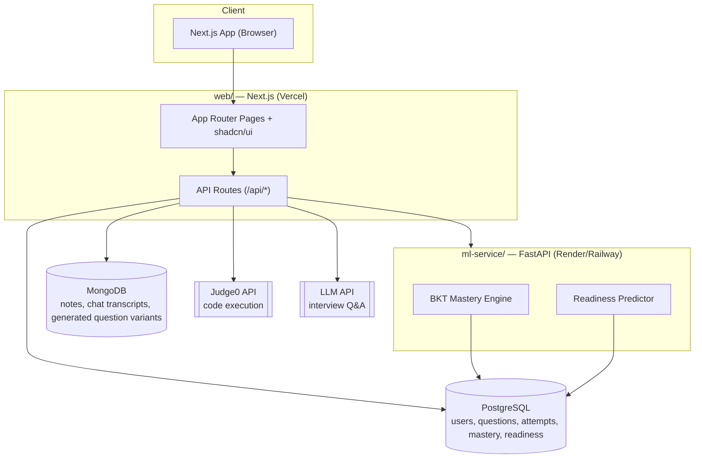

# Architecture

## 1. System Overview

Two deployable services, two data stores, and two external APIs:

## 2. Why Two Services Instead of One

The web app (Next.js) handles everything user-facing and CRUD-shaped: auth, content, attempts, dashboard rendering. The ML service (FastAPI) is separate because:

- The BKT and readiness models are Python (scikit-learn), and rewriting them in JS would mean losing the standard ML tooling.
- It lets the ML logic be tested, versioned, and explained independently — important for the "is this real ML" evaluation criteria.
- It keeps the Next.js API routes simple: they call the ML service rather than embedding model logic inline.

Full reasoning is recorded in [`docs/decisions/002-adaptive-model.md`](decisions/002-adaptive-model.md).

## 3. Request Flow: A Student Answers a Question

1. Student submits an answer in the UI (`web/app/(practice)/...`).
2. A Next.js API route (`/api/attempts`) validates the submission and writes an `Attempt` row to Postgres.
3. The API route calls the ML service's `/mastery/update` endpoint with the student's attempt history for that subtopic.
4. The ML service runs the BKT update (see [`docs/adaptive-engine.md`](adaptive-engine.md)), returns the new mastery probability and a recommended next topic.
5. The API route persists the updated `MasteryScore` row and returns the result to the client.
6. On a slower cadence (e.g., after every N attempts, not every single one), the API route also calls `/readiness/predict` to refresh the student's overall readiness score.

## 4. Request Flow: Mock Interview

1. Student picks a subject/topic and starts a session (`/api/interview/start`).
2. The API route pulls the student's current mastery vector for that subject from Postgres, so weak subtopics are weighted into question selection.
3. The LLM API is called with a prompt that includes the topic and difficulty target — see [`docs/decisions/003-llm-strategy.md`](decisions/003-llm-strategy.md) for exactly what goes in that prompt and why.
4. Generated questions and the student's answers/evaluations are stored in MongoDB (`interview_sessions` collection) since this content is unstructured and varies in shape question to question.

## 5. Service Boundaries

| Concern | Owned by |
|---|---|
| Auth, routing, all pages | `web/` (Next.js) |
| CRUD on users/questions/attempts | `web/` API routes → Postgres |
| Mastery scoring, readiness prediction | `ml-service/` (FastAPI) |
| Code execution grading | Judge0 (external), called from `web/` API routes |
| Interview question generation/evaluation | LLM API (external), called from `web/` API routes |
| Notes, chat transcripts, generated content | MongoDB, read/written from `web/` |

## 6. Deployment Topology

See [`docs/deployment.md`](deployment.md) for the full guide. In short: `web/` deploys to Vercel, `ml-service/` deploys to Render or Railway as a separate service, Postgres is hosted (Neon/Supabase), MongoDB is Atlas. The web app talks to the ML service over HTTPS using an internal service URL set via `ML_SERVICE_URL`.
